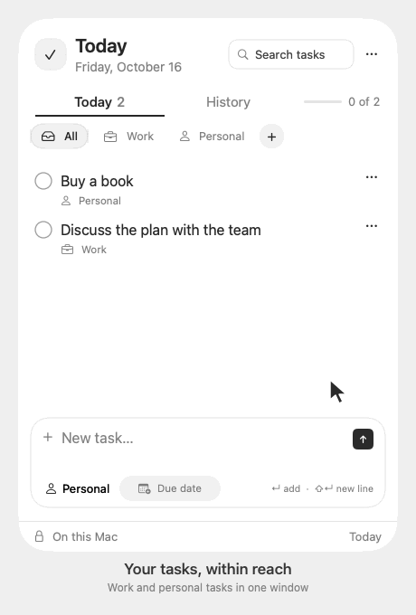
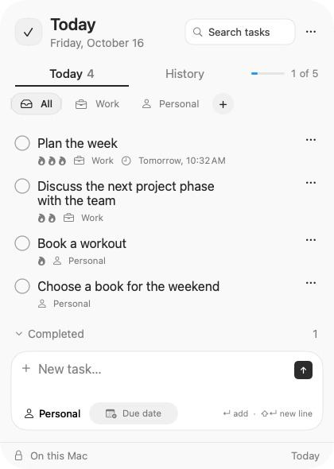
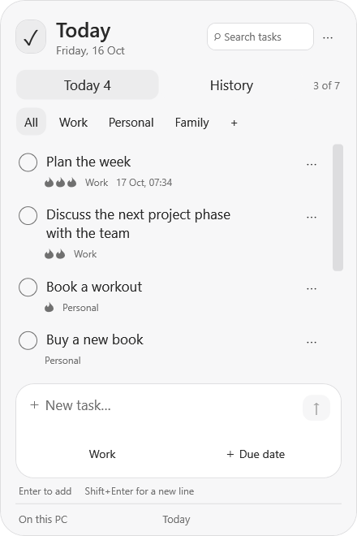
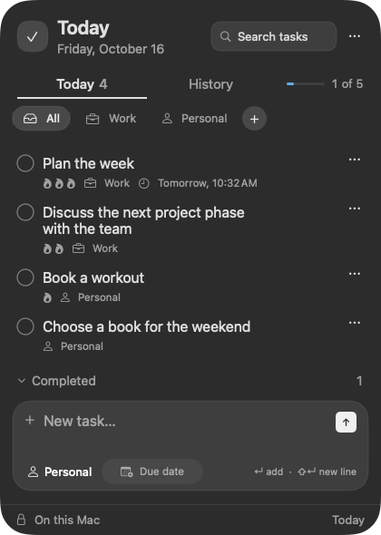
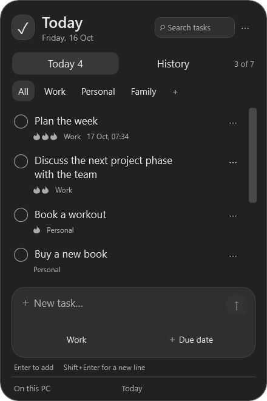

<p align="center">
  <a href="README.md">Русский</a> · <strong>English</strong>
</p>

<p align="center">
  
</p>

<h1 align="center">Today</h1>

<p align="center">
  Your tasks, always within reach.
</p>

**Today is a simple to-do list for Mac and Windows.** Keep track of work and personal
tasks, set deadlines, and check things off in a small, distraction-free window.
On Mac, Today lives in the menu bar. On Windows, it sits in the system tray next to the clock.
Click its icon to open your list. On Windows, hovering does not open the window;
Mac also supports a quick preview on hover.

No account, no internet connection, and no subscription required. Your tasks stay on
your computer; there is no automatic sync between devices.

**Language:** Today uses Russian when your system's primary language is Russian,
and English otherwise. This applies to both Mac and Windows. Restart Today after
changing the system language. Your task text and custom category names stay unchanged.

## Download Today

**Current version: 1.6.1 for Mac and Windows.** Choose your computer below.
You do not need a GitHub account to download the app.

| Your computer | Download |
| --- | --- |
| **Mac · macOS 13 Ventura or later** — one app for Intel and Apple Silicon | **[Download for Mac](https://github.com/IwanBelenko/TodayBar/releases/download/v1.6.1/Today-1.6.1-mac.zip)** |
| **Windows 11 · Intel or AMD** — most PCs and laptops | **[Download for Windows](https://github.com/IwanBelenko/TodayBar/releases/download/v1.6.1/Today-1.6.1-windows-x64.zip)** |
| **Windows 11 · ARM** — such as Snapdragon laptops | **[Download for Windows ARM](https://github.com/IwanBelenko/TodayBar/releases/download/v1.6.1/Today-1.6.1-windows-arm64.zip)** |

Not sure which Windows download you need? Search for **System Information** in Start
and check **System Type**: `x64` means the standard Windows download, `ARM64` means
Windows ARM. [Microsoft's guide](https://www.microsoft.com/en-us/software-download/windows11arm64).

[What's new in 1.6.1](https://github.com/IwanBelenko/TodayBar/releases/tag/v1.6.1) ·
[Previous releases](https://github.com/IwanBelenko/TodayBar/releases)

<details>
<summary>What about Windows 10 or older systems?</summary>

Windows 10 compatibility depends on the edition and its ESU/LTSC support. See the
[.NET 10 requirements](https://learn.microsoft.com/en-us/dotnet/core/install/windows).
There is no separate build for older systems. This version of Today does not support
Windows 7/8, 32-bit Windows, or macOS earlier than 13.

</details>

## See Today in action

A short Mac demo: add a task, set its priority, search, and check it off.
About 8 seconds: follow the cursor; a small ring marks each click.
The demo uses sample tasks, not personal data.

<p align="center">
  
</p>

[View a still frame without animation](docs/demos/v1.6.1/today-en.png). Screenshots of both platforms are below.

## See the app

Today on Mac and Windows. These screenshots use sample tasks, not personal data.

| Mac · light theme | Windows · light theme |
| :---: | :---: |
|  |  |

<details>
<summary>View the dark theme</summary>

| Mac · dark theme | Windows · dark theme |
| :---: | :---: |
|  |  |

</details>

## Install

### Mac

1. Download the Mac ZIP above and double-click it to extract the app.
2. Move `Today.app` to **Applications** and open it.
3. Look for the checkmark icon in the menu bar at the top of your screen.

The app is not notarized by Apple. If macOS blocks the first launch, check that you
downloaded it from this repository. If you trust the app, go to **System Settings →
Privacy & Security** and use **Open Anyway**, if available.
[Apple's explanation of this warning](https://support.apple.com/en-us/102445).

### Windows

1. Download the ZIP for your processor above.
2. Right-click the ZIP → **Extract All**. Use a permanent folder, such as `Documents\Today`.
3. Open the extracted `Today.exe`. You do not need to install .NET separately.
4. Find the checkmark icon next to the clock. If it is hidden, expand the tray icons.

The Windows app does not yet have a verified publisher signature, so SmartScreen may
show a warning. Do not disable Windows security. If your work computer blocks the app,
contact your administrator.

**Updating:** quit the old app from its tray/menu-bar menu, then replace it with the
new file. Your saved tasks remain in place. If you move the Windows app to another
folder, turn `Launch at Startup` off and on again to update its startup path.

## What you can do

- **Separate work and personal tasks.** Use Work, Personal, or your own categories, such as Family or Home.
- **Keep important tasks at the top.** Give a task one, two, or three monochrome flames. Higher-priority tasks move up automatically.
- **Set deadlines.** Pick a date from the calendar and type the time. Overdue tasks are marked; Windows reminders are shown while Today is running in the tray.
- **Find tasks quickly.** Search both current tasks and history.
- **Keep a history.** Completed tasks are crossed out. The selected category filters both Today and History.
- **Keep things simple.** A compact window with light and dark themes, no account, and no ads.

Type a task and press **Enter** to add it. **Shift + Enter** starts a new line.
Use a task's **`…`** menu to change its priority, deadline, or category, copy its text, or delete it.

## Launch at startup

Right-click the Today icon and enable `Launch at Startup`. Click again to turn it off.
On Windows, this applies only to your user account and does not require administrator rights.

On Mac, you can also manage startup manually in **System Settings → General → Login Items**:
add `Today.app` from Applications.

## Controls

| Action | Result |
| --- | --- |
| Hover over the icon | Windows: no window opens. Mac: quick preview |
| Left-click the icon | Windows: open or hide the window. Mac: pin or close it |
| Right-click the icon | Open the app menu |
| Click Today / History | Switch between current tasks and history |
| Select a category | Filter tasks, history, and counters; the selection stays when switching tabs |
| Click `+` next to categories | Create a custom category |
| Right-click a custom category | Delete the category without deleting its tasks |
| `⌘F` / `Ctrl+F` | Focus search in the current tab and category |
| `Esc` in search, or the clear button | Clear the search |
| Task `…` → Priority | Set or remove priority |
| Task `…` → Add / Change due date… | Add or edit the deadline |
| Click the time field | Type a time manually |
| `−` / `+` next to the time | Adjust by 15 minutes |
| `⌘C` / `⌘V` / `⌘X`, or `Ctrl` on Windows | Copy, paste, or cut text |
| Right-click a completed task | Copy its full text |
| `Enter` while editing | Save the task |
| `Shift + Enter` | Insert a line break |
| Click the round checkbox | Complete or restore a task |

Search matches all entered words, including text across line breaks. Switching tabs
keeps both the query and category. Progress and counters follow the category, but are
not narrowed by search. Adding a task clears the query.

History's clear action removes completed tasks only from the selected category; in
All, it clears all history. Confirmation is required. Bulk clearing is hidden
while searching.

Priority order is **3 flames → 2 → 1 → no flames**. Within the same priority, unfinished
tasks keep creation order and completed tasks use newest completion first. Completed
tasks remain in their own section; history keeps its day groups and sorts by priority
within each day. Existing and new tasks have no priority by default.

## Your data

Mac stores tasks and categories here:

```text
~/Library/Application Support/TodayBar/tasks.json
~/Library/Application Support/TodayBar/categories.json
```

Windows uses `%APPDATA%\TodayBar\tasks.json` and `%APPDATA%\TodayBar\categories.json`.
On Windows, a `.bak` file keeps the previous saved version. A damaged file is reported
as a read error, not silently replaced with an empty list.

Uninstalling the app does not automatically delete these files. To transfer your tasks
between computers or platforms, quit Today on both computers, make backups, and copy
**both JSON files** into the destination's TodayBar data folder. This replaces the
destination's list; it does not merge lists. Deadlines are stored in UTC and displayed
in local time. There is no automatic sync.

### Windows reminders

While running in the tray, Today checks deadlines every 15 seconds and shows a system
notification. Overdue tasks stay marked, and missed deadlines are checked at the next
launch. Each deadline is notified once per session. No reminders are sent after Today
has quit or while the PC is off. Enable startup if you want reminders whenever you use
your computer. Do Not Disturb and Windows notification settings can hide alerts.

## For developers

<details>
<summary>Build, test, and architecture</summary>

### macOS

Use a Mac with Xcode or Xcode Command Line Tools installed:

```bash
git clone https://github.com/IwanBelenko/TodayBar.git
cd TodayBar
./scripts/build-app.sh
```

The result is `dist/Today.app`: a universal Intel + Apple Silicon app with an ad-hoc signature.
Tests require Swift 6 or later; the test framework's minimum OS can be newer than the
app's macOS 13 deployment target.

```bash
./scripts/test.sh
TODAYBAR_TEST_LANGUAGE=ru TODAYBAR_SNAPSHOT_DIR="$PWD/.build/ui-previews/ru" ./scripts/test.sh
TODAYBAR_TEST_LANGUAGE=en TODAYBAR_SNAPSHOT_DIR="$PWD/.build/ui-previews/en" ./scripts/test.sh
```

Tests cover older JSON files, persistence, priorities and ordering, category-scoped
search and history, language selection, data compatibility, and Enter handling. The language
override above is test-only and is excluded from release builds. Optional UI snapshots use sample data and
the real rounded `TodayPanel`, with transparent-corner checks. Tests do not read personal tasks.

### Windows

Install [.NET SDK 10](https://dotnet.microsoft.com/download/dotnet/10.0), then run from
the repository root in PowerShell:

```powershell
dotnet run --project Windows/Today.Core.Tests
dotnet run --project Windows/Today.Windows
./scripts/build-windows.ps1 -Runtime win-x64
./scripts/build-windows.ps1 -Runtime win-arm64
```

Self-contained executables are written to `dist/Today-win-x64/Today.exe` and
`dist/Today-win-arm64/Today.exe`. The `--startup` option starts quietly in the tray.
To cross-build on Mac/Linux:

```bash
dotnet publish Windows/Today.Windows -c Release -r win-x64 --self-contained true \
  -p:PublishSingleFile=true -p:IncludeNativeLibrariesForSelfExtract=true -p:PublishTrimmed=false \
  -o dist/Today-win-x64
```

Windows Desktop reference/runtime packs are downloaded from NuGet. There are no
third-party package dependencies. Cross-building does not prove that the app runs on Windows.

On Windows, `Today.exe --smoke-test <folder>` checks click-only tray event bindings,
the native interface, search, history, menus, task entry, clipboard, and the calendar.
It checks Russian and English and saves light/dark screenshots in `ru-RU` and `en-US`
subfolders using temporary data, without changing startup
settings, displaying a tray icon, or accessing personal tasks.

[GitHub Actions](https://github.com/IwanBelenko/TodayBar/actions/workflows/build.yml)
runs checks on Windows x64 and builds both x64 and ARM64 executables. Manual checks of
the actual system tray, reminders, startup, different DPI settings, and physical ARM64
hardware are separate; screenshots and a successful build do not replace them.

Keep README screenshots in versioned folders under `docs/screenshots/`. Windows
snapshots come from the successful build's `Today-Windows-previews` artifact.

README GIFs use captures of the production `TodayPanel` with in-memory sample tasks.
They are scripted UI demonstrations, not desktop recordings; personal data is never loaded.
The cursor and short click rings are added during GIF assembly, with motion at 20 fps.
The scenario checks Add, Clear search, and Complete clicks in the test window,
plus sorting and search. Priority is changed programmatically: a caption shows
the menu path, without recording the open menu. Enter has a separate test.
To regenerate with standard macOS and Swift tools:

```bash
TODAYBAR_TEST_LANGUAGE=ru TODAYBAR_DEMO_DIR="$PWD/.build/demo/ru" ./scripts/test.sh --filter recordReadmeDemo
swift scripts/make-demo.swift .build/demo/ru docs/demos/v1.6.1/today-ru.gif
TODAYBAR_TEST_LANGUAGE=en TODAYBAR_DEMO_DIR="$PWD/.build/demo/en" ./scripts/test.sh --filter recordReadmeDemo
swift scripts/make-demo.swift .build/demo/en docs/demos/v1.6.1/today-en.gif
```

### Architecture

```text
AppSources/TodayBar
├── App             # lifecycle and macOS menu-bar integration
├── Data            # local JSON storage
├── Domain          # task models
└── Presentation    # SwiftUI interface and view state

Windows
├── Today.Core          # models, filters, sorting, atomic JSON storage
├── Today.Core.Tests    # portable tests with temporary data
└── Today.Windows       # WPF, tray, calendar, startup, notifications
```

The platforms share a compatible data format, not a server or a cross-language bridge.
Development artifacts are available from successful Actions runs (`Today-universal`,
`Today-windows-x64`, `Today-windows-arm64`). They require GitHub sign-in and expire;
use the release links at the top of this page for normal installation.

</details>

## Privacy

Today does not use the network or send analytics. Data stays on your computer.
On Mac, notification permission is requested when you first add a deadline.
On Windows, Today uses system tray notifications; the current user's startup registry
entry is changed only when you choose `Launch at Startup`. Startup is never enabled
automatically on first launch.
