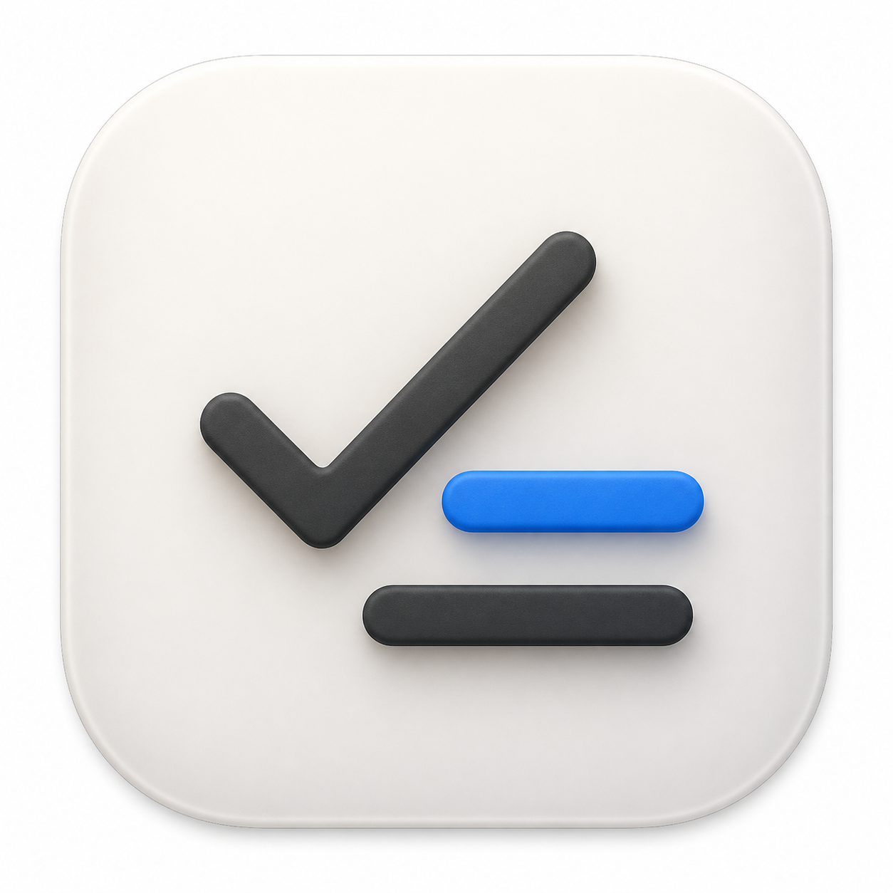

<p align="center">
  
</p>

<h1 align="center">Today</h1>

<p align="center">
  Ваши дела — всегда под рукой.
</p>

**Today — простой список дел для Mac и Windows.** Записывайте рабочие и личные задачи,
назначайте сроки и отмечайте сделанное, не открывая большое отдельное окно.
На Mac Today находится в верхней строке меню, на Windows — возле часов.
Наведите курсор на значок, чтобы посмотреть дела, или нажмите на него, чтобы начать работу.

Приложение работает без интернета и регистрации. Задачи хранятся только на вашем
компьютере; автоматической синхронизации между устройствами нет.

## Скачать Today

**Актуальная версия — 1.6.0.** Выберите свой компьютер. Вход в GitHub для скачивания не нужен.

| Ваш компьютер | Что скачать |
| --- | --- |
| **Mac · macOS 13 Ventura или новее** — одна версия для Intel и чипов Apple M-серии | **[Скачать для Mac](https://github.com/IwanBelenko/TodayBar/releases/download/v1.6.0/Today-1.6.0-mac.zip)** |
| **Windows 11 · Intel или AMD** — большинство обычных ноутбуков и ПК | **[Скачать для Windows](https://github.com/IwanBelenko/TodayBar/releases/download/v1.6.0/Today-1.6.0-windows-x64.zip)** |
| **Windows 11 · ARM** — например, ноутбук с процессором Snapdragon | **[Скачать для Windows ARM](https://github.com/IwanBelenko/TodayBar/releases/download/v1.6.0/Today-1.6.0-windows-arm64.zip)** |

Не знаете, какая у вас Windows-версия? Найдите через «Пуск» приложение **«Сведения о системе»**
и посмотрите **«Тип системы»**: `x64` — обычная версия, `ARM64` — версия ARM.
[Инструкция Microsoft](https://www.microsoft.com/ru-ru/software-download/windows11arm64).

[Что нового в 1.6.0](https://github.com/IwanBelenko/TodayBar/releases/tag/v1.6.0) ·
[Предыдущие версии](https://github.com/IwanBelenko/TodayBar/releases)

<details>
<summary>У меня Windows 10 или более старая система</summary>

Для Windows 10 совместимость зависит от редакции и поддержки ESU/LTSC — см.
[требования .NET 10](https://learn.microsoft.com/dotnet/core/install/windows).
Отдельной сборки для старых систем нет. Windows 7/8, 32-разрядная Windows и macOS ниже 13
этой версией Today не поддерживаются.

</details>

## Как установить

### На Mac

1. Скачайте архив по ссылке **«Скачать для Mac»** и откройте его двойным нажатием.
2. Перетащите `Today.app` в папку **«Программы»** и запустите.
3. Найдите значок с галочкой в верхней строке меню — это Today.

Если macOS не разрешает первый запуск из-за неподтверждённого разработчика,
проверьте, что файл скачан из этого репозитория. Если вы доверяете приложению,
откройте **«Системные настройки → Конфиденциальность и безопасность»** и подтвердите
открытие кнопкой **«Всё равно открыть»**, если она доступна.
[Подробнее об этом предупреждении у Apple](https://support.apple.com/ru-ru/102445).

### На Windows

1. Скачайте подходящий архив по ссылке выше.
2. Нажмите на архив правой кнопкой → **«Извлечь всё»**. Сохраните приложение в постоянную папку, например «Документы → Today».
3. Откройте извлечённый `Today.exe`. Ничего дополнительно устанавливать не нужно.
4. Найдите значок с галочкой возле часов. Если его не видно, нажмите стрелку скрытых значков.

У Windows-версии пока нет подтверждённой подписи издателя, поэтому SmartScreen может
показать предупреждение. Не отключайте защиту Windows целиком. Если запуск заблокирован
правилами рабочего компьютера, обратитесь к администратору.

**Обновление:** завершите старый Today через меню значка и замените приложение новым.
Сохранённые задачи останутся на месте. Если переместили Windows-приложение в другую папку,
выключите и снова включите `Launch at Startup`, чтобы обновить путь автозапуска.

## Что умеет Today

- **Разделять дела:** «Работа», «Личное» и ваши разделы — например, «Семья» или «Дом».
- **Показывать важное первым:** поставьте задаче от одного до трёх огоньков — она поднимется в списке.
- **Помогать со сроками:** выберите день в календаре и введите время. Просроченные дела будут отмечены; в Windows напоминания приходят, пока Today работает в трее.
- **Находить нужную задачу:** поиск работает и в текущих делах, и в истории.
- **Сохранять сделанное:** выполненные задачи зачёркиваются и остаются в истории. Выбранный раздел применяется к обеим вкладкам.
- **Не отвлекать:** компактное окно, светлая и тёмная темы, никаких аккаунтов и рекламы.

Чтобы добавить дело, напишите его и нажмите **Enter**. **Shift + Enter** переносит текст
на новую строку. Приоритет, срок, раздел, копирование и удаление находятся в меню **`…`** у задачи.

## Автозапуск

На обеих платформах нажмите правой кнопкой на значок Today и включите `Launch at Startup`. Повторный клик снимает галочку и отключает автозапуск. В Windows настройка действует только для текущего пользователя и не требует прав администратора.

На Mac настройку также можно проверить вручную:

1. Откройте «Системные настройки».
2. Перейдите в «Основные → Объекты входа».
3. Нажмите `+` и выберите `Today.app` из папки «Программы».

## Управление

| Действие | Результат |
| --- | --- |
| Навести курсор на значок | Быстро показать список |
| Нажать левой кнопкой | Закрепить или закрыть окно |
| Нажать правой кнопкой | Открыть меню приложения |
| `Launch at Startup` в меню | Включить или отключить запуск вместе с компьютером |
| Нажать «Сегодня» или «История» | Переключить раздел на всей ширине вкладки |
| Нажать «Работа», «Личное» или свой раздел | Отфильтровать текущие задачи, историю и счётчики; выбор сохраняется при переключении вкладок |
| Нажать `+` рядом с разделами | Создать пользовательский раздел |
| Правый клик по пользовательскому разделу | Удалить раздел, сохранив его задачи |
| Поле «Поиск задач» или `⌘F` / `Ctrl+F` | Искать по тексту в текущей вкладке и выбранном разделе |
| `Esc` в поле поиска или крестик | Сбросить поиск |
| `…` у задачи → «Приоритет» | Выбрать низкий, средний, высокий приоритет или убрать отметку |
| `…` у задачи → «Добавить / Изменить срок…» | Открыть календарь и изменить дату или время |
| `…` у задачи → «Раздел», «Скопировать задачу», «Удалить задачу» | Изменить раздел, скопировать полный текст или удалить задачу |
| Нажать на часы или минуты | Ввести цифровое время вручную |
| Нажать `−` или `+` рядом со временем | Изменить время на 15 минут |
| `⌘C` / `⌘V` / `⌘X` | Копировать, вставить или вырезать текст |
| Правый клик по выполненной задаче | Скопировать задачу целиком |
| `Enter` при вводе | Сохранить задачу |
| `Shift + Enter` | Добавить новый абзац |
| Нажать на чекбокс | Выполнить или вернуть задачу |

В Windows вместо `⌘` используются сочетания с `Ctrl`. Текст существующей задачи сохраняется по Enter или при переходе из редактора; Shift+Enter добавляет строку.

Поиск проверяет все введённые слова, включая текст на новых строках. Переключение между «Сегодня» и «История» сохраняет запрос **и выбранный раздел**. Счётчик вкладки, просрочка и прогресс учитывают раздел, но не сужаются поисковым запросом. «Все» показывает все разделы и задачи без раздела. Добавление новой задачи сбрасывает запрос.

В истории кнопка «Очистить» удаляет выполненные дела только выбранного раздела; в «Все» — всю историю. Перед удалением есть подтверждение. При поиске массовая очистка скрыта.

Приоритет обозначен нейтральными огоньками под текстом: один — низкий, два — средний, три — высокий. Задачи автоматически идут в порядке **3 → 2 → 1 → без огоньков**, включая поиск и выбранный раздел. При изменении приоритета положение обновляется сразу. При одинаковом приоритете незавершённые задачи сохраняют порядок создания, выполненные — обратный порядок завершения. Выполненные остаются в своём блоке; история сохраняет группировку по дням, сортируя по приоритету внутри каждого дня. Приоритет сохраняется вместе с задачей; у существующих и новых задач по умолчанию его нет.

## Где хранятся данные

Задачи и пользовательские разделы сохраняются локально:

```text
~/Library/Application Support/TodayBar/tasks.json
~/Library/Application Support/TodayBar/categories.json
```

В Windows используются `%APPDATA%\TodayBar\tasks.json` и `%APPDATA%\TodayBar\categories.json`.
Предыдущая сохранённая версия каждого файла остаётся рядом с расширением `.bak`.
Повреждённый файл не заменяется пустым списком: приложение сообщает об ошибке чтения.

Удаление приложения не удаляет эти файлы автоматически. Для переноса между Mac и Windows
завершите Today на обоих компьютерах, сохраните резервную копию, затем скопируйте **оба JSON-файла**
в папку TodayBar нового компьютера. Перенос заменяет его текущий список, а не объединяет списки.
Сроки хранятся как моменты времени UTC и отображаются в местном часовом поясе. Автосинхронизации нет.

### Напоминания Windows

Пока Today работает в трее, он проверяет сроки каждые 15 секунд и показывает системное
уведомление. Просроченные задачи остаются помеченными в списке; при следующем запуске
показывается напоминание о пропущенных сроках. Один срок не напоминается повторно в той же
сессии. После полного выхода из Today или при выключенном ПК Windows-версия не отправляет
уведомления — включите автозапуск, если нужны постоянные напоминания. «Не беспокоить»
и настройки Windows могут скрывать уведомления.

## Для разработчиков

<details>
<summary>Сборка из исходников, тесты и архитектура</summary>

### Сборка для macOS

Для сборки нужен Mac с актуальными Xcode Command Line Tools или Xcode.

```bash
git clone https://github.com/IwanBelenko/TodayBar.git
cd TodayBar
./scripts/build-app.sh
```

Готовое приложение появится в:

```text
dist/Today.app
```

Скрипт собирает единое приложение для Intel и Apple Silicon и подписывает его локальной ad-hoc подписью.

### Windows из исходников

Для разработки установите [.NET SDK 10](https://dotnet.microsoft.com/download/dotnet/10.0).
В PowerShell из корня репозитория:

```powershell
dotnet run --project Windows/Today.Core.Tests
dotnet run --project Windows/Today.Windows
./scripts/build-windows.ps1 -Runtime win-x64
./scripts/build-windows.ps1 -Runtime win-arm64
```

Готовые автономные приложения: `dist/Today-win-x64/Today.exe` и `dist/Today-win-arm64/Today.exe`.
Режим `--startup` открывает приложение сразу в трее, не показывая окно.
Для кросс-сборки на Mac/Linux с .NET SDK 10:

```bash
dotnet publish Windows/Today.Windows -c Release -r win-x64 --self-contained true \
  -p:PublishSingleFile=true -p:IncludeNativeLibrariesForSelfExtract=true -p:PublishTrimmed=false \
  -o dist/Today-win-x64
```

Кросс-сборка не проверяет работу окна на Windows. Приложение не требует сторонних пакетов;
Windows Desktop reference/runtime packs для сборки загружаются из NuGet.

### Проверки

Для тестов нужен Swift 6 или новее; минимальная версия системы для запуска тестов зависит от установленной библиотеки Swift Testing (в текущих Command Line Tools — macOS 14). Само приложение по-прежнему собирается для macOS 13+.

```bash
./scripts/test.sh
```

Тесты проверяют чтение старых файлов без приоритетов, сохранение новых полей, сортировку по огонькам и её обновление, поиск с фильтром разделов, порядок дней истории и обработку Enter только активным редактором. Они используют временные данные и не читают личный список задач.

Windows: `dotnet run --project Windows/Today.Core.Tests` проверяет поиск, приоритеты,
сроки и переходы суток/DST, историю по разделам, совместимость JSON, сохранение и ошибки записи.
На Windows команда `Today.exe --smoke-test <папка>` запускает отдельный режим с временными
данными: создаёт окно, проверяет фильтрацию, действия меню, добавление и копирование,
сохраняет снимки светлой/тёмной темы и календаря. Автозапуск и личные данные не затрагиваются.
GitHub Actions запускает эти проверки на Windows x64 и собирает оба варианта EXE.
Ручная проверка наведения в трее, уведомлений, автозапуска, разных DPI и ARM64 остаётся
отдельной проверкой на соответствующем устройстве — снимки интерфейса её не заменяют.

Для дополнительных снимков интерфейса на тестовых данных:

```bash
TODAYBAR_SNAPSHOT_DIR="$PWD/.build/ui-previews" ./scripts/test.sh
```

В набор входят светлая и тёмная темы, найденная задача, пустая выдача и поиск по истории. При необходимости можно указать установленный SDK через переменную `SDKROOT`.

### Архитектура

Проект разделён на независимые слои:

```text
AppSources/TodayBar
├── App             # жизненный цикл и интеграция со строкой меню
├── Data            # локальное JSON-хранилище
├── Domain          # модель задачи
└── Presentation    # SwiftUI-интерфейс и состояние экрана
```

Windows-реализация находится рядом и не заменяет нативный Swift-код:

```text
Windows
├── Today.Core          # модели, фильтры, сортировка и атомарное JSON-хранилище
├── Today.Core.Tests    # переносимые проверки на временных данных
└── Today.Windows       # WPF, трей, календарь, автозапуск и уведомления
```

Связь платформ — совместимый формат данных и одинаковое поведение, без сервера и межъязыкового моста.

Промежуточные сборки доступны в [GitHub Actions](https://github.com/IwanBelenko/TodayBar/actions/workflows/build.yml).
В успешном запуске `main` откройте **Artifacts**: `Today-universal`, `Today-windows-x64` или
`Today-windows-arm64`. Для их скачивания нужен вход в GitHub, а срок хранения ограничен.
Для обычной установки используйте постоянные ссылки на релиз в начале этой страницы.

</details>

## Конфиденциальность

Today не использует сеть и не отправляет аналитику. Данные остаются на компьютере.
В macOS разрешение на системные уведомления запрашивается при добавлении первого срока.
Windows использует системные уведомления из трея и запись автозапуска текущего пользователя
только по нажатию `Launch at Startup`. Приложение не меняет автозапуск автоматически при первом открытии.
