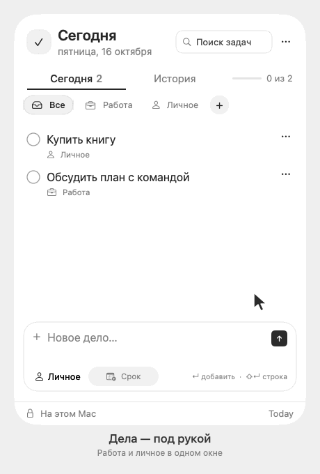
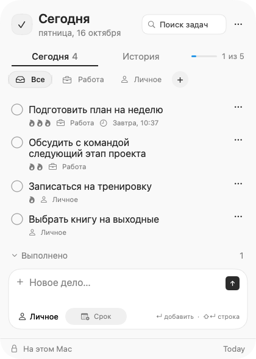
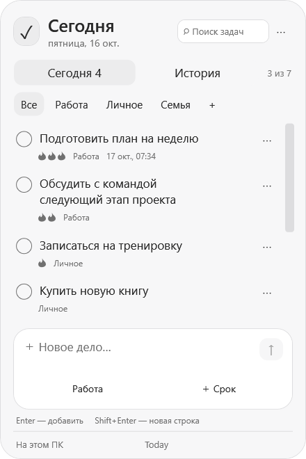
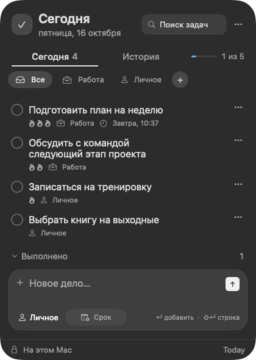
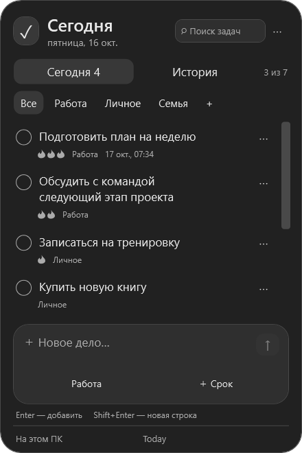

  <strong>Русский</strong> · <a href="README.en.md">English</a>

  

<h1 align="center">Today</h1>

  Ваши дела — всегда под рукой.

Минималистичный список дел для Mac и Windows. Записывайте задачи, выделяйте важное
и отмечайте сделанное — в компактном окне, которое открывается одним кликом по значку приложения.

## Скачать

- **[Для Mac](https://github.com/IwanBelenko/TodayBar/releases/download/v1.6.1/Today-1.6.1-mac.zip)** — macOS 13+, Intel и Apple Silicon.
- **[Для Windows](https://github.com/IwanBelenko/TodayBar/releases/download/v1.6.1/Today-1.6.1-windows-x64.zip)** — Windows 11, Intel и AMD.
- **[Для Windows ARM](https://github.com/IwanBelenko/TodayBar/releases/download/v1.6.1/Today-1.6.1-windows-arm64.zip)** — устройства на Snapdragon и других ARM-процессорах.

## Today в действии

Демонстрация на Mac.

  

[Статичный кадр без анимации](docs/demos/v1.6.1/today-ru.png).

## Всё нужное для ваших дел

- **Работа и личное.** Разделяйте задачи по готовым разделам или создавайте свои.
- **Важное — наверху.** Отмечайте приоритет огоньками: чем их больше, тем выше задача.
- **Сроки под контролем.** Назначайте дату и время, получайте напоминания и замечайте просроченное.
- **Ничего не теряется.** Находите задачи поиском и возвращайтесь к сделанному в истории.

Светлая и тёмная темы. Русский и английский язык — автоматически по настройкам системы.

## Как выглядит Today

| Mac · светлая тема | Windows · светлая тема |
| :---: | :---: |
|  |  |

Посмотреть тёмную тему

| Mac · тёмная тема | Windows · тёмная тема |
| :---: | :---: |
|  |  |

## Просто начать

**Mac:** распакуйте архив, перенесите Today в «Программы» и запустите.

**Windows:** распакуйте архив и откройте Today.exe.

При первом запуске система может показать предупреждение о неподтверждённом разработчике.
[Помощь с установкой и предупреждениями](docs/GUIDE.md#как-установить).

Today работает без интернета и регистрации. Данные хранятся на вашем компьютере;
синхронизации между устройствами нет.

[Руководство пользователя](docs/GUIDE.md) · [Для разработчиков](docs/DEVELOPMENT.md)
